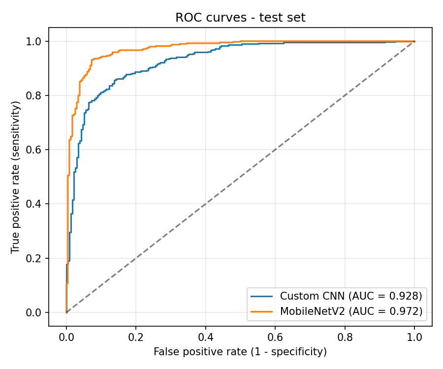

# Pneumonia Detection from Chest X-ray Images Using Deep Learning

Binary classification of chest X-rays (**NORMAL** vs **PNEUMONIA**) with
TensorFlow/Keras, comparing a **custom CNN** trained from scratch against
**MobileNetV2 transfer learning** with fine-tuning.


---

## Project structure

```
pneumonia_detection/
├── .vscode/launch.json      # one-click Run & Debug entries for every step
├── dataset/
│   ├── train/ NORMAL/  PNEUMONIA/
│   └── test/  NORMAL/  PNEUMONIA/
├── models/                  # trained .keras files are saved here
├── results/                 # created automatically: plots, reports, metrics
├── utils.py                 # shared settings (image size, split, paths, helpers)
├── check_setup.py           # verifies packages + dataset before training
├── train_cnn.py             # Model 1: custom CNN
├── transfer_learning.py     # Model 2: MobileNetV2 (frozen -> fine-tuned)
├── evaluate.py              # test-set metrics, confusion matrices, ROC curves
├── predict.py               # predict a single X-ray (or a folder of X-rays)
└── requirements.txt
```

---

## 1. Set up in VS Code (one time)

1. **Install Python 3.11 or 3.12** from python.org (tick *"Add python.exe to PATH"*
   on Windows). Very new Python versions sometimes don't have TensorFlow builds yet,
   so avoid the newest release if `pip install tensorflow` fails.
2. **Install VS Code** and the **Python** extension (by Microsoft).
3. **Open the folder:** *File → Open Folder… →* `pneumonia_detection`.
4. **Open a terminal:** *Terminal → New Terminal*, then create a virtual environment:

   ```bash
   python -m venv .venv
   ```

   Activate it:

   | System | Command |
   |---|---|
   | Windows (PowerShell) | `.venv\Scripts\Activate.ps1` |
   | Windows (cmd) | `.venv\Scripts\activate.bat` |
   | macOS / Linux | `source .venv/bin/activate` |

   You should now see `(.venv)` at the start of the terminal line.
5. **Select the interpreter:** `Ctrl+Shift+P` → *Python: Select Interpreter* → pick
   the one inside `.venv`.
6. **Install the packages:**

   ```bash
   pip install -r requirements.txt
   ```

## 2. Add the dataset

Download **Chest X-Ray Images (Pneumonia)** from Kaggle
(<https://www.kaggle.com/datasets/paultimothymooney/chest-xray-pneumonia>).
Copy its `train/` and `test/` folders into `dataset/` so the layout is exactly:

```
dataset/train/NORMAL/*.jpeg      dataset/train/PNEUMONIA/*.jpeg
dataset/test/NORMAL/*.jpeg       dataset/test/PNEUMONIA/*.jpeg
```

The Kaggle `val/` folder is **not needed** — 20% of `train/` is split off for
validation automatically (seed 42), and `test/` stays untouched until evaluation.

## 3. Run the project (in order)

Either type the commands in the VS Code terminal, **or** open *Run and Debug*
(`Ctrl+Shift+D`), choose a step from the dropdown and press **F5**.

| Step | Command | What it does |
|---|---|---|
| 1 | `python check_setup.py` | Checks Python, packages and dataset folders |
| 2 | `python train_cnn.py` | Trains the custom CNN → `models/best_custom_cnn.keras` |
| 3 | `python transfer_learning.py` | Trains + fine-tunes MobileNetV2 → `models/best_mobilenetv2.keras` (downloads ImageNet weights on first run) |
| 4 | `python evaluate.py` | Evaluates both models on the test set → `results/` |
| 5 | `python predict.py path/to/xray.jpeg` | Predicts one image (no path = random test image) |

**Do a quick test run first** to make sure everything works before a long training run:

```bash
python train_cnn.py --epochs 2
python transfer_learning.py --epochs-frozen 1 --epochs-finetune 1
python evaluate.py
```

Then run the full training (without the `--epochs` flags).

---

## Method summary

- **Input:** 224 × 224 RGB (grayscale X-rays repeated to 3 channels).
- **Split:** 80% train / 20% validation from `dataset/train`; `dataset/test` held out.
- **Class imbalance:** the dataset has many more PNEUMONIA images, so class weights are applied during training (disable with `--no-class-weights`).
- **Augmentation (training only):** small rotation (≈ ±10°), zoom (10%), translation (5%). No vertical flips or extreme rotations.
- **Custom CNN:** 5 × [Conv2D → BatchNorm → ReLU → MaxPool] → GlobalAveragePooling → Dropout → Dense(128) → Dropout → Dense(1, sigmoid). Adam (1e-3), binary cross-entropy.
- **MobileNetV2:** ImageNet weights, original head removed, new sigmoid head.
  Stage 1 trains the head with the backbone frozen (Adam 1e-3); Stage 2 unfreezes the top 40 backbone layers (BatchNorm kept frozen) and fine-tunes with Adam 1e-5.
- **Callbacks:** best-model checkpoint on `val_loss`, early stopping, learning-rate reduction on plateau, CSV training log.
- Preprocessing (rescaling) is built **inside** each model, so `predict.py` feeds raw images and always matches training.

## Outputs in `results/`

| File | Contents |
|---|---|
| `*_training_curves.png` | Loss, accuracy, precision, recall per epoch |
| `*_training_log.csv`, `*_history.json` | Raw training history |
| `confusion_matrix_<model>.png` | Confusion matrix with counts and row percentages |
| `classification_report_<model>.txt` | Precision / recall / F1 per class, specificity, ROC-AUC |
| `predictions_<model>.csv` | Per-image probability and whether it was correct |
| `roc_curves.png` | ROC curves for both models |
| `metrics_summary.csv` | Side-by-side comparison table |

**Why recall matters:** recall (sensitivity) is the share of real pneumonia cases the
model catches. A missed pneumonia (false negative) is usually more serious than a false
alarm, so report recall alongside accuracy.

## Results



| Model | Accuracy | Precision | Recall | F1 | Specificity | ROC-AUC |
|---|---:|---:|---:|---:|---:|---:|
| Custom CNN | 0.7692 | 0.7330 | 0.9923 | 0.8431 | 0.3974 | 0.9282 |
| MobileNetV2 (fine-tuned) | 0.8734 | 0.8388 | 0.9872 | 0.9069 | 0.6838 | 0.9718 |

These values were measured on the held-out test set and saved in `results/metrics_summary.csv`.

---

## Troubleshooting

| Problem | Fix |
|---|---|
| `No module named 'tensorflow'` but you installed it | VS Code is using a different Python. `Ctrl+Shift+P` → *Python: Select Interpreter* → `.venv`. Make sure `(.venv)` shows in the terminal. |
| PowerShell: *"running scripts is disabled on this system"* | Run once: `Set-ExecutionPolicy -Scope CurrentUser RemoteSigned`, then activate again. |
| `pip install tensorflow` finds no matching version | Your Python is too new or too old. Install Python 3.11 or 3.12 and recreate `.venv`. |
| `FileNotFoundError ... Missing: ['NORMAL', ...]` | Dataset layout is wrong (often a nested `chest_xray/chest_xray/` folder). Run `python check_setup.py`. |
| Out of memory / computer freezes | Use a smaller batch: `--batch-size 16` (or 8). |
| MobileNetV2 weight download fails | The first run needs internet to fetch the ImageNet weights. |
| Training is slow | Normal on CPU. Recent TensorFlow versions don't use NVIDIA GPUs natively on Windows; GPU training needs WSL2 or Linux. Use a quick test run to check everything first. |
| Yellow squiggles under TensorFlow imports in VS Code | A Pylance display quirk with TensorFlow's lazy loading; the code still runs. |
| Lines like `oneDNN custom operations are on` | Informational TensorFlow messages — safe to ignore. |

---

## CV description

**Pneumonia Detection from Chest X-ray Images Using Deep Learning**

- Developed a deep learning-based pneumonia detection system using chest X-ray images.
- Designed and trained a custom CNN in TensorFlow/Keras for binary classification of Normal and Pneumonia cases.
- Applied transfer learning with a pretrained MobileNetV2 and two-stage fine-tuning.
- Performed image preprocessing, augmentation, class-imbalance handling, model training and evaluation.
- Compared models using accuracy, precision, recall, F1-score and confusion matrix.
