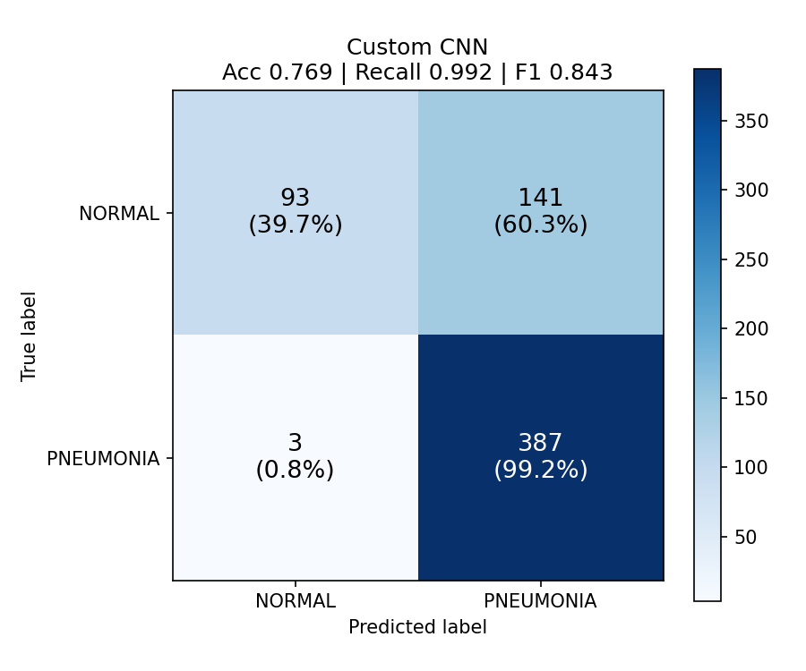
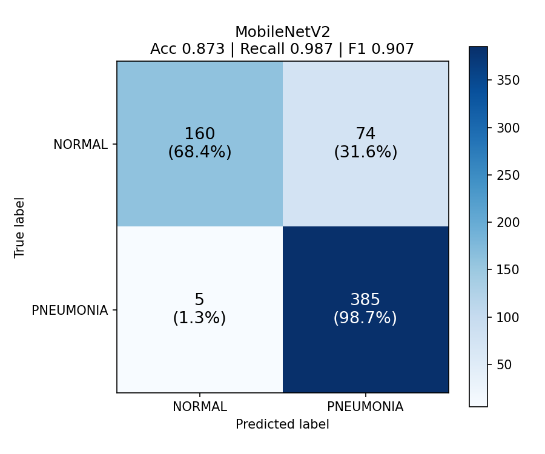

# Pneumonia Detection from Chest X-ray Images Using Deep Learning

Binary classification of chest X-rays (**NORMAL** vs **PNEUMONIA**) with
TensorFlow/Keras, comparing a **custom CNN** trained from scratch against
**MobileNetV2 transfer learning** with fine-tuning.


---

## Project structure

```
pneumonia_detection/
├── .vscode/launch.json      # one-click Run & Debug entries for every step
├── dataset/
│   ├── train/ NORMAL/  PNEUMONIA/
│   └── test/  NORMAL/  PNEUMONIA/
├── models/                  # trained .keras files are saved here
├── results/                 # created automatically: plots, reports, metrics
├── utils.py                 # shared settings (image size, split, paths, helpers)
├── check_setup.py           # verifies packages + dataset before training
├── train_cnn.py             # Model 1: custom CNN
├── transfer_learning.py     # Model 2: MobileNetV2 (frozen -> fine-tuned)
├── evaluate.py              # test-set metrics, confusion matrices, ROC curves
├── predict.py               # predict a single X-ray (or a folder of X-rays)
└── requirements.txt
```

---

## 1. Set up in VS Code (one time)

1. **Install Python 3.11 or 3.12** from python.org (tick *"Add python.exe to PATH"*
   on Windows). Very new Python versions sometimes don't have TensorFlow builds yet,
   so avoid the newest release if `pip install tensorflow` fails.
2. **Install VS Code** and the **Python** extension (by Microsoft).
3. **Open the folder:** *File → Open Folder… →* `pneumonia_detection`.
4. **Open a terminal:** *Terminal → New Terminal*, then create a virtual environment:

   ```bash
   python -m venv .venv
   ```

   Activate it:

   | System | Command |
   |---|---|
   | Windows (PowerShell) | `.venv\Scripts\Activate.ps1` |
   | Windows (cmd) | `.venv\Scripts\activate.bat` |
   | macOS / Linux | `source .venv/bin/activate` |

   You should now see `(.venv)` at the start of the terminal line.
5. **Select the interpreter:** `Ctrl+Shift+P` → *Python: Select Interpreter* → pick
   the one inside `.venv`.
6. **Install the packages:**

   ```bash
   pip install -r requirements.txt
   ```

## 2. Add the dataset

Download **Chest X-Ray Images (Pneumonia)** from Kaggle
(<https://www.kaggle.com/datasets/paultimothymooney/chest-xray-pneumonia>).
Copy its `train/` and `test/` folders into `dataset/` so the layout is exactly:

```
dataset/train/NORMAL/*.jpeg      dataset/train/PNEUMONIA/*.jpeg
dataset/test/NORMAL/*.jpeg       dataset/test/PNEUMONIA/*.jpeg
```

The Kaggle `val/` folder is **not needed** — 20% of `train/` is split off for
validation automatically (seed 42), and `test/` stays untouched until evaluation.

## 3. Run the project (in order)

Either type the commands in the VS Code terminal, **or** open *Run and Debug*
(`Ctrl+Shift+D`), choose a step from the dropdown and press **F5**.

| Step | Command | What it does |
|---|---|---|
| 1 | `python check_setup.py` | Checks Python, packages and dataset folders |
| 2 | `python train_cnn.py` | Trains the custom CNN → `models/best_custom_cnn.keras` |
| 3 | `python transfer_learning.py` | Trains + fine-tunes MobileNetV2 → `models/best_mobilenetv2.keras` (downloads ImageNet weights on first run) |
| 4 | `python evaluate.py` | Evaluates both models on the test set → `results/` |
| 5 | `python predict.py path/to/xray.jpeg` | Predicts one image (no path = random test image) |

**Do a quick test run first** to make sure everything works before a long training run:

```bash
python train_cnn.py --epochs 2
python transfer_learning.py --epochs-frozen 1 --epochs-finetune 1
python evaluate.py
```


---

## Method summary

This project tackles a binary image-classification problem: determine whether a chest X-ray is normal or pneumonia-positive. The workflow follows a standard deep-learning pipeline for medical image analysis, with careful attention to class imbalance, model selection, and evaluation on a held-out test set.

- **Input data:** Chest X-ray images are resized to 224 × 224 pixels and converted from grayscale to 3-channel RGB by repeating the single channel across the red, green, and blue planes. This keeps the images compatible with pretrained CNN backbones while preserving the original radiographic content.
- **Dataset split:** The training set is divided into 80% training and 20% validation using a fixed seed (`seed=42`), while the original test set remains completely untouched until final evaluation.
- **Class imbalance handling:** The Pneumonia class is overrepresented in the dataset, so class weights are applied during training to reduce the model’s bias toward the majority class. This is especially important because in a screening task the cost of missing pneumonia cases is much higher than a false alarm.
- **Data augmentation:** Only the training images are augmented using small transformations such as rotation (about ±10°), horizontal/vertical shifts, and limited zoom. These augmentations improve generalization without introducing unrealistic distortions that could hide abnormalities in chest radiographs.
- **Custom CNN architecture:** The first model is a lightweight CNN built from scratch. It consists of stacked convolutional blocks with Batch Normalization, ReLU activation, and max pooling, followed by global average pooling, dropout, and fully connected classification layers. A final sigmoid output produces a probability score for the positive class.
- **Transfer learning approach:** The second model uses MobileNetV2 pretrained on ImageNet. The original classification head is removed and replaced with a sigmoid output layer. Training is done in two stages: first, the new head is trained while the backbone remains frozen; then, selected upper convolutional layers are unfrozen and fine-tuned with a lower learning rate to adapt the features to chest X-ray classification.
- **Optimization and regularization:** Both models use binary cross-entropy loss and Adam optimization. Training includes early stopping, learning-rate reduction on plateau, and checkpointing to keep the best validation model rather than the last epoch.
- **Model-specific preprocessing:** Rescaling is embedded inside each Keras model, so raw images can be passed directly to `predict.py` without manually normalizing them. This ensures the same preprocessing is used consistently during training and inference.

## Outputs in `results/`

| File | Contents |
|---|---|
| `*_training_curves.png` | Loss, accuracy, precision, recall per epoch |
| `*_training_log.csv`, `*_history.json` | Raw training history |
| `confusion_matrix_<model>.png` | Confusion matrix with counts and row percentages |
| `classification_report_<model>.txt` | Precision / recall / F1 per class, specificity, ROC-AUC |
| `predictions_<model>.csv` | Per-image probability and whether it was correct |
| `roc_curves.png` | ROC curves for both models |
| `metrics_summary.csv` | Side-by-side comparison table |

**Why recall matters:** recall (sensitivity) is the share of real pneumonia cases the
model catches. A missed pneumonia (false negative) is usually more serious than a false
alarm, so report recall alongside accuracy.

## Results

### ROC curves


### Confusion matrices




| Model | Accuracy | Precision | Recall | F1 | Specificity | ROC-AUC |
|---|---:|---:|---:|---:|---:|---:|
| Custom CNN | 0.7692 | 0.7330 | 0.9923 | 0.8431 | 0.3974 | 0.9282 |
| MobileNetV2 (fine-tuned) | 0.8734 | 0.8388 | 0.9872 | 0.9069 | 0.6838 | 0.9718 |

These values were measured on the held-out test set and saved in `results/metrics_summary.csv`.

The confusion matrices show that MobileNetV2 reduces false positives substantially compared with the custom CNN while maintaining a very high pneumonia recall. In medical screening, this is important because the model must identify true pneumonia cases while minimizing unnecessary alarms.

---


## CV description

**Pneumonia Detection from Chest X-ray Images Using Deep Learning**

- Developed a deep learning-based pneumonia detection system using chest X-ray images.
- Designed and trained a custom CNN in TensorFlow/Keras for binary classification of Normal and Pneumonia cases.
- Applied transfer learning with a pretrained MobileNetV2 and two-stage fine-tuning.
- Performed image preprocessing, augmentation, class-imbalance handling, model training and evaluation.
- Compared models using accuracy, precision, recall, F1-score and confusion matrix.
